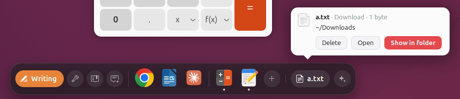
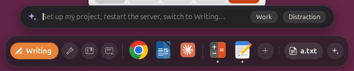

# DeskAI

An AI-aware dock for GNOME. It helps you stay on what you're doing, tells you when something needs
you, and puts your desk back the way it was after a logout. The AI part is optional.

**[Download for Ubuntu and Debian](https://github.com/RanggaEghaPermana/deskai/releases/latest/download/deskai_all.deb)**, or see [other ways to install](#install).





- **Focus modes.** Writing, Building, Studying, Social: each with its own apps, allowed and blocked
  sites, and notification rules. A nudge when you drift, and a daily focus recap.
- **Inbox on the dock.** WhatsApp messages and AI agents (Claude Code, Codex, Gemini CLI, and the
  desktop AI apps) tell you when they're done or need you, even while the screen was locked. One click takes
  you there.
- **Command bar.** Press `Super+/` or click the sparkle and type what you want: "set up my project",
  "restart the server", "close my project", "how long did I focus today?". It can only do what's on a
  fixed list, and neither it nor the AI ever comes up with a command to run. Plain requests, in English or Indonesian, are done instantly with no AI:
  switching mode, setting up or closing a project, servers, opening things, your focus time, a mode's lists,
  which projects have work not committed or pushed.
- **My Presets.** Your own routines, the kind nothing could guess: open this app, do that by hand, switch to that mode, run
  this command. Write the steps in the My Presets window, pick the words that start them, like "setup discord", and type
  those words in the command bar. It takes no AI, and a near miss asks you first.
- **Servers on the dock.** The dev servers and database in your projects get a status dot, including the
  ones you started yourself in a terminal. If one DeskAI started stops, you see why, and one click restarts
  it or opens its log. Closing a project asks before stopping anything DeskAI didn't start, your database
  included, and tells you if it has files not committed or commits not pushed.
- **Docker in the command bar.** Start, stop or restart a Compose project by name, along with the containers it
  needs from other projects, and see which images you have. Running containers get a status dot too.
- **Who has which port.** Ask who has a port, what's free and what's in the way. A Docker project whose port is
  taken says who has it, instead of failing halfway through starting.
- **Room on your computer.** A card when memory or a disk runs low. Ask about your RAM or storage to see what's
  using it, and ask to clear it to see which caches can go. The card's button or "turn off warnings" stops the
  warnings.
- **Music on the dock.** While something plays, in a music app or a browser tab, the dock shows what it
  is with previous, pause and next. Click the song to go to the player. It leaves when the player closes,
  or after half an hour on pause.
- **Who gets through.** The first time someone new is held during a focus mode, the dock shows you the
  message and asks once: keep holding, or always show them. Notifications that are plainly urgent, like a
  deadline or an error, come through anyway.
- **Pick up where you left off.** After a logout, your windows come back with their size, place and
  workspace, your terminals with their tabs and Claude Code conversations, your dev servers, your
  database and Chrome's tabs. It always asks first.
- **Workday routine.** On workday mornings it offers to set up your project like last time.
- **Ready after setup.** No AI and nothing to teach it first. Setup puts the apps you use in each mode, from what's
  installed and what GNOME has seen you open, and your projects are found in your home folder. "Set up my project"
  starts what a project's own files say it runs, and uses your Claude Code sessions when it has them.
- **Smart places.** After a download or a screen recording, the dock offers to open it or show it,
  and it learns the folders you go back to. A suggestion leaves the dock after a minute, and clicking Files
  on the dock then takes you there: your latest screenshot, download or recording, or the folder you closed
  Files on.
- **Window motion.** Smooth animations when you switch between windows.
- **Smooth login.** The login animation plays once your desktop and extensions have loaded, so it doesn't
  stutter.
- **Break reminders.** A small card after two hours without a pause. One click turns it off, and
  `breaks.after_minutes` in `~/.config/deskai/modes.json` sets how long.

## Requirements

| | |
|---|---|
| Desktop | **GNOME 46, 50 or 51** on Wayland (Ubuntu 24.04 or 26.04, for example). Other GNOME versions and other desktops such as KDE aren't supported. |
| Needed | Python 3, PyGObject, GTK 4, libadwaita, systemd. The `.deb` and the setup window take care of these. |
| Recommended | **Ptyxis** and **Google Chrome**: terminals and browser tabs come back after a logout with these. |
| Optional | The AI: **[Ollama](https://ollama.com)**, which setup can download for you, **Claude Code** or an Anthropic API key. Everything else works without it. |

It's used daily on Ubuntu 26.04. On Ubuntu 24.04 it has been run in a test session in a virtual machine, not yet on a
full desktop, and GNOME 51 has only been checked against its source. Ubuntu 24.04 doesn't package Ptyxis, so without it
terminals don't come back after a logout there.

## Install

### Ubuntu and Debian

1. **[Download DeskAI](https://github.com/RanggaEghaPermana/deskai/releases/latest/download/deskai_all.deb)** (a `.deb`, under 200 KB).
2. Double-click it and choose Install, or run `sudo apt install ./deskai_all.deb`.
3. **DeskAI Setup** opens by itself. Follow the steps, and if it doesn't open, it's in the app grid.
4. Log out and back in once. The dock is there from then on.

To update, install the newer `.deb` the same way. DeskAI Setup opens with a list of what's new and an **Update** button, and
everything you chose stays as it is. Log out and back in once, and that's it. A release only asks you something if it
brought something new to choose. It doesn't look for updates by itself.

### Other distributions with GNOME 46, 50 or 51

1. Download **Source code (zip)** from the [latest release](https://github.com/RanggaEghaPermana/deskai/releases/latest) and unpack it.
2. In that folder, run `bash setup.sh`.

The setup window copies what it needs, so you can delete the download afterwards.

## What leaves your computer

With AI **off**, or with **Ollama**, nothing does: the model runs on your computer. If you let setup download the local AI,
that's the one time it goes out for something: Ollama from `github.com`, and the model from `registry.ollama.ai`. They get a
download request and nothing about you.

With **Claude**, these are sent to it, through your Claude Code login or your API key:

- the titles of the windows you use, and the notifications held back during a focus mode (password
  managers are left out, and you can add more apps under `llm.exclude_apps` in `~/.config/deskai/modes.json`);
- when you use the command bar: what you typed, your modes, the names of your projects, servers and
  installed apps, and today's focus time. No file contents or full paths. Your presets are never sent, and a preset's
  keyword, typed as it is, runs without reaching it.

Using an API key costs money, charged by Anthropic.

## Choosing the AI

DeskAI Setup offers Ollama, Claude Code's login, an API key, or no AI, with Ollama already picked. If it isn't on your
computer, setup says how big the download is, about 2.9 GB, and gets it in the background if you leave it picked. You
can use your computer meanwhile, logging out doesn't lose what's done, and the dock says when it's ready. Pick **No AI**
and nothing downloads. It's picked for you instead if the connection is metered, and if you move to a metered one later the
download waits, unless that's the connection you chose it on. Ollama can't be picked if the computer is short of memory
or disk. With Claude Code's login, if Claude stops working (signed out, plan ended, limit reached) and
Ollama has the model, DeskAI carries on with it and tries Claude again every hour.

Ollama is free and private. It only powers the command bar, loading the model when you type and letting it go a
couple of minutes later: small local models judge real windows and notifications badly (see `evals/real.py`), so
with Ollama those are decided by the lists and what DeskAI has learned from you, and for notifications that aren't
plainly urgent, your answer about the sender. It also can't rewrite your modes, though allowing or blocking something
works without it. The default model, `qwen3:1.7b`, takes 1.4 GB
and needs about 2 GB of free memory while thinking. On a laptop CPU it answers in about 5 seconds, or 25 when it has
to load first, so it only gets what the lists have no shape for, like a question. A request to set up, close or open
something that the lists can't place gets told so right away. Pick another with `llm.ollama_model` in
`~/.config/deskai/modes.json`.

Everything else stays on your computer in `~/.config/deskai` and `~/.local/state/deskai`.

## How it learns

The AI gets the hard cases only. For each window, DeskAI goes through, in order: your own word on it, your
allow and block lists, a built-in list of what's plain (docs for a coding mode, shops and games anywhere), a small
classifier trained on your corrections, and only then Claude, if you use it. With Ollama, what's still unclear
counts as neutral, so nothing interrupts you on a guess.

To correct it, press `Super+/` and click **Work** or **Distraction**, or right-click the active mode on the dock,
about the window in front of you. Choosing **Allow** or moving to another mode on a nudge counts too. A few times a
day, at a pause, it also asks about a window you spent a while on that it couldn't place. All of it stays in
`~/.local/state/deskai/learned.json`, and the classifier retrains itself right away, with no GPU.

What you say about senders is in `~/.local/state/deskai/senders.json`: their names, never their messages.
`deskai senders` lists them, and `deskai senders --forget NAME` takes your word back.

The command bar shows what you last asked for, and `Up` and `Down` go through it. Your last 30 requests are in
`~/.local/state/deskai/commands.json`, readable only by you, and `Delete` forgets the one you're on.

Your focus time per day is in `~/.local/state/deskai/stats/`, with the titles of the windows that distracted you.
Each day's file is deleted after 90 days.

When a step of setup fails, what the tool said goes in `~/.local/state/deskai/setup.log`, readable only by you. It's for
bug reports, and removing DeskAI deletes it.

## What it changes on your computer

- **A background service and a command**: `deskaid.service` for your user, `~/.local/bin/deskai`, and, unless you
  installed the `.deb`, a copy of the app in `~/.local/share/deskai` and launchers for DeskAI Setup and My Presets. Removing
  DeskAI takes them away.
- **The local AI**, only if you let setup download it: Ollama and its model in `~/.local/share/deskai/ollama`, and two services
  for your user, `deskai-ollama.service` and, while it downloads, `deskai-local-ai.service`. Your own Ollama, if you have
  one, is used and left alone, with only the model added to it. Removing DeskAI takes away what it downloaded.
- **GNOME's switch for user extensions**, if you had it off, since the dock can't run without it. Removing DeskAI turns
  it off again.
- **Hooks in your AI agents**, only if you turn that on during setup: entries in
  `~/.claude/settings.json`, `~/.gemini/settings.json` and `~/.codex/config.toml`. A backup is kept as `*.deskai-bak`.
  Removing DeskAI then puts each file back exactly as it was and deletes the backup, or if the file changed in some
  other way meanwhile, just takes the entries out and leaves the backup there. A file DeskAI can't change is left as it
  is, and setup says so.
- **Resuming Claude Code.** Restoring your desk and the workday routine resume conversations with the
  flags they had. If you run Claude Code with `--dangerously-skip-permissions`, it comes back that way.
- **Ptyxis' saved session** is set aside as `session.gvariant.deskai-bak` during a restore, so tabs
  don't come back twice. Removing DeskAI puts it back if Ptyxis hasn't made a new one.
- **Presets** are in `~/.config/deskai/presets.json`, and only do what you wrote. A command in one runs in bash with your
  account, from your home folder, so it can do anything you can, and DeskAI can't tell whether it's safe. It shows you each
  command before it first runs, and again if it changes, and notes the ones you've allowed in
  `~/.local/state/deskai/presets-seen.json`. What a command says goes in the journal, for `deskai presets log`. The AI can't
  write, change or start a preset.
- **Clearing caches** only happens when you press the button on the card. It empties the caches of npm, pip, yarn
  and Composer and your thumbnails, and prunes Docker's build cache: all things their tools fill again.
- **Starting and stopping system services** from the command bar goes through GNOME's password prompt.
- **Starting your database without a password** is off unless you ask for it:
  `deskai routine allow-db` prints a polkit rule for you to install.
- **A second extension, DeskAI Login**, holds back GNOME's login animation until your extensions have
  loaded, so the desktop can appear a moment later. Turn it off in the Extensions app if you'd rather see
  it sooner. On GNOME 46 and 51 it stays out of the way, since sessions start in the overview there.
- **Other docks stay off** for as long as DeskAI's dock is here: Ubuntu Dock, Dash to Dock, Dash to Panel and the like, so
  you never get two on top of each other. They're only turned off, not uninstalled. The Extensions app can't turn one on
  meanwhile, and one that comes back on some other way, from an update or a reset, goes off again a couple of seconds
  later. A card says so each time. Removing DeskAI turns them back on. If the dock can't load, on a newer GNOME say, they
  come back by themselves. Docks that are separate apps, such as Plank, aren't touched.
- **The color before the desktop**, on Ubuntu: `com.ubuntu.login-screen background-color` is set to black, unless
  you already chose one, so there's no gray flash at login. Removing DeskAI puts it back.

## Using it

Click a mode on the dock to switch to it. Click the app you're in to minimize its windows on this workspace,
click it again to bring them back, and right-click it to pick one window. Point at an open app to see its windows,
minimized ones too, and click one to go to it. Everything else is in the dock's menus
and cards, and a few things are also on the command line:

```sh
deskai doctor        # check that everything is working
deskai status        # mode, window, inbox
deskai stats         # today's focus recap
deskai senders       # who always gets through, and who stays held
deskai session       # what would come back after a logout
deskai presets       # your own routines: write them, or add list or log
deskai routine       # the workday routine
deskai hooks install # let AI agents report to the dock
```

Modes live in `~/.config/deskai/modes.json`, and the dock picks up changes right away. If you make a mistake in
it, a card says where and DeskAI keeps going by the last version that worked. Should anything have to save over a
file it can't read, the old one is kept next to it as `modes.json.broken-…`.

## Remove

Uninstall the package in App Center, or run `sudo apt remove deskai`: that removes DeskAI for everyone logged in, and your
other docks come back. Or open **DeskAI Setup** and choose **Remove DeskAI**, then uninstall the package. Your modes, presets and stats
stay, unless you tick the box in DeskAI Setup to delete them too. Anyone else who uses this computer and isn't logged in at
that moment keeps what was set up for them: they can open DeskAI Setup before the package goes, and if it's gone already, their
other docks are still off, and `gnome-extensions enable ubuntu-dock@ubuntu.com` turns Ubuntu Dock back on.

## Development

```sh
./install.sh            # runs right from this clone
./uninstall.sh          # add --purge to delete your modes, presets and stats too
dev/check.sh            # everything a change has to pass
dev/nested.sh           # a throwaway GNOME Shell with its own HOME, for testing
dev/smoke.sh            # tries the dock in that shell, on its own
packaging/build-deb.sh  # builds dist/deskai_<version>_all.deb from what's committed
python3 -m unittest discover tests
python3 evals/run.py    # scores the AI pipeline on set cases (needs Ollama, or add --no-model)
```

`extension/` holds the GNOME Shell extensions, `daemon/` is the background service (`deskaid`) and the
`deskai` command, and `setup/` is the setup window. GNOME only loads extension code when you log
in, so test extension changes in `dev/nested.sh`.

## Reporting bugs

Open an [issue](https://github.com/RanggaEghaPermana/deskai/issues) with your distribution, what
happened, and the output of `deskai doctor`. Check the output for anything private before posting.

## Contributing

Pull requests are welcome, and [CONTRIBUTING.md](CONTRIBUTING.md) says what they need. Contributions are accepted
under the same license as the project.

## Terms and license

DeskAI is free software, licensed under [GPL-3.0-or-later](LICENSE).

- You can use it for anything, including commercial work, at no cost.
- You can study it, change it and share it.
- If you distribute it or a changed version, you have to keep this license and provide the source code.
- It comes **with no warranty**. You use it at your own risk.

This is an early release. DeskAI uses parts of GNOME Shell that can change, so a new GNOME version
may break it until it's updated. It isn't affiliated with GNOME, Anthropic, Google or Meta; their names
and products belong to their owners.
